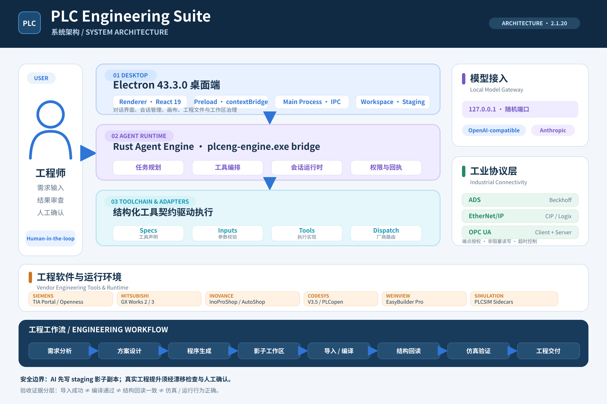
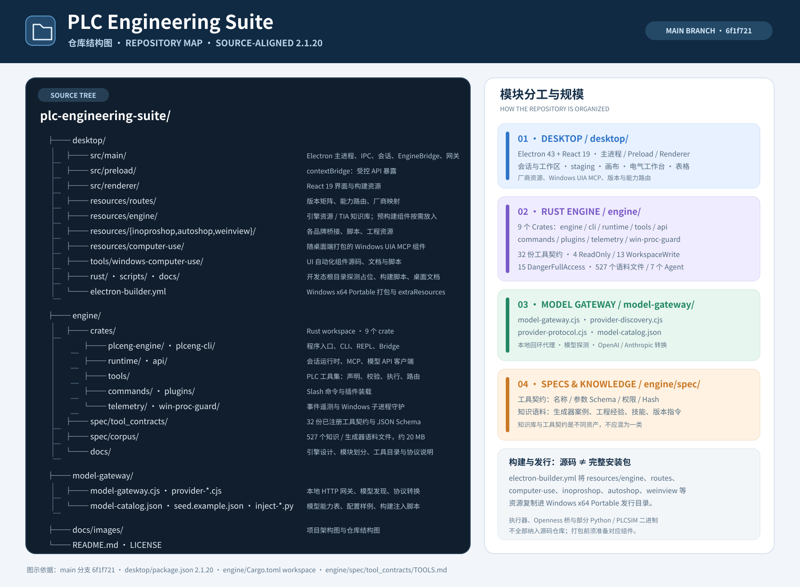

# PLC Engineering Suite

**面向工业自动化工程的 AI 辅助工作台**  
*An evidence-driven engineering workbench for PLC, HMI, and industrial automation.*

PLC Engineering Suite 是一套面向工业自动化工程场景的 AI 辅助工程平台。项目将 Electron 桌面应用、Rust Agent 运行时、多品牌工程软件桥接、本地模型网关与工业通信能力整合在一起，帮助工程师把需求理解、控制方案设计、PLC/HMI 工程产物生成、IDE 交互、诊断与验证组织成一条可审查、可追踪的工作流。

它的目标不只是“让 AI 写出一段 PLC 代码”，而是让 AI 参与真实工程流程时，始终处于**明确的权限边界、可回退的工作区、人工确认和结构化验收证据**之下。

> **工程原则：编译通过不等于程序正确；生成成功不等于工程交付完成。**  
> 系统会区分导入、编译、结构回读和运行行为等不同层级的证据，不用模型的置信度代替工程验证。

---

## 项目结构与系统架构

> 以下两张图按当前 `main` 分支重新梳理，版本基线为 **2.1.20**。图示区分桌面端、Rust 引擎、本地模型网关、工程软件适配器与工业协议层；仓库结构同时标出了源码目录、工具契约、外置运行资源与发行包资源边界。

### 系统架构

桌面端负责交互、会话与工程工作区治理；Rust Agent 负责任务规划和工具编排；工具层按“声明—校验—执行—路由”组织；本地模型网关独立处理模型协议与密钥。工程写入先进入 staging，经过漂移检查和人工确认后才提升到真实工程。

### 仓库结构

仓库由 `desktop/`、`engine/`、`model-gateway/` 和项目文档组成。Rust workspace 包含 9 个 crate；工具契约在源码树中维护，运行时语料是否提供则以发行包和本地部署清单为准。部分执行器、厂商桥和运行时二进制需要在打包前准备，不应把源码克隆等同于完整发行环境。

---

## 项目概览

| 项目 | 说明 |
| --- | --- |
| 项目类型 | AI 辅助工业自动化工程平台 |
| 桌面端 | Electron 43.3.0、React 19 |
| Agent 引擎 | Rust workspace |
| 模型接入 | 本地模型网关；OpenAI 兼容接口与 Anthropic 协议转换 |
| 工程集成 | Siemens TIA Portal、Mitsubishi GX Works、Inovance InoProShop / AutoShop、CODESYS、Weinview EasyBuilder Pro 等 |
| 工业通信 | Beckhoff ADS、EtherNet/IP（CIP）、OPC UA 客户端与服务端 |
| 当前公开发行版 | **2.1.20 · Windows x64** |
| 开源许可 | MIT |

## 核心能力

### 1. 多品牌 PLC / HMI 工具链

项目通过独立桥接层适配不同厂商的工程软件和文件格式，将厂商差异收敛在工具路由与适配器中。

| 平台 | 集成方向 | 主要工程对象 / 能力 |
| --- | --- | --- |
| Siemens TIA Portal | Openness 桥接、环境诊断与版本路由 | LAD、SIMATIC SD、GRAPH、HMI 画面、Watch 表等工程生成与交换路径 |
| Mitsubishi GX Works2 / GX Works3 | 原生工程适配与文本交换 | 工程文件、梯形图 CSV、标签表、ST 等相关工具 |
| Inovance InoProShop | Python / MCP 桥接 | LAD 生成、工程对象与参数处理 |
| CODESYS V3.5 | Python 桥接与 PLCopen XML / ST 路径 | LAD、ST、POU 等工程对象 |
| Inovance AutoShop（H5U） | 文本桥接与工程数据处理 | H5U 工程、模块参数及仿真相关工作流 |
| Weinview EasyBuilder Pro | PowerShell + C# 适配 | HMI 画面、标签、配方、告警和趋势等对象 |

**兼容性说明：** 上表描述的是仓库中已建立的工具链和集成方向，不代表所有厂商软件版本、CPU 型号和工程操作均已完成现场验证。具体能力以运行时诊断、版本路由和对应工具返回的证据为准。

### 2. PLC 与 HMI 工程产物

围绕结构化工程描述，提供面向不同平台的生成与交换工具，包括：

- Siemens TIA：LAD 块 XML、SIMATIC SD 文本、GRAPH 块、HMI 画面与列表、Watch 表等。
- CODESYS / InoProShop：LAD 网络、指令、控制配方、ST 与 POU 相关生成路径。
- Mitsubishi：梯形图列表 CSV、标签表等交换产物。
- PLC 代码检查：针对部分 Mitsubishi FX 系列及 Siemens S7-200 AWL / ST 场景提供规则校验与诊断。

当前引擎仓库维护 **32 份已注册工具契约**，包含工具名称、参数 JSON Schema、权限声明等信息。工具契约是调用接口的依据；实际可执行能力仍受目标软件、版本、权限和运行环境约束。

### 3. 工业通信与运行时可观测性

2.1.20 版本加入工业协议层，将不同设备通信方式封装为统一的读写入口：

- **Beckhoff ADS**：变量读写与状态读取。
- **EtherNet/IP（CIP）**：Logix 系列 Tag 访问。
- **OPC UA**：客户端连接与服务端数据暴露。

网络端点需要经过显式授权。协议调用采用非阻塞执行与超时控制，避免设备掉线或通信异常长期阻塞桌面主进程。

### 4. 电气工作台与工程数据

- **电气工作台**：原理图绘制，支持 PDF 矢量导出与 PNG 导出。
- **表格工作区**：Excel 工作簿读取、编辑与导出，并对同一工作簿的写操作进行并发控制。
- **变量管理**：信号表、变量值读取与变化订阅，以及跨工程引用。
- **会话检查点**：为长时间任务提供检查点、恢复与确认流程。

### 5. 可替换的 AI 模型接入

模型供应商与 Agent 引擎解耦。桌面端启动本地网关，引擎统一通过 OpenAI 兼容端点发起请求，由网关负责协议转换、能力探测和密钥保护。

- 支持 OpenAI 兼容服务端点。
- 支持 Anthropic 原生协议与 OpenAI 消息格式之间的转换，包括工具调用和流式响应。
- 可由使用者指定模型服务地址、模型名称与 API Key。
- Windows 环境下使用系统级加密（DPAPI）保护密钥；本地网关仅监听回环地址，并使用启动时生成的一次性令牌进行进程间鉴权。

更换模型服务通常只需修改本地配置，不需要修改 PLC 工具实现。

---

## 工程可靠性设计

工业自动化工程的风险不在于“能不能生成代码”，而在于错误改动能否被发现、隔离和撤销。因此，项目将安全边界放在工作流设计中，而不是只依赖提示词约束。

### 影子工作区与显式提交

绑定真实工程后，桌面端先建立 staging 影子副本。Agent 的文件修改先落在影子工作区，工程师审查后再决定是否提升到真实工程。

~~~text
草稿工作区
    │
    ▼
绑定真实工程
    │
    ▼
Staging 影子副本 ◄── Agent 在此生成和修改
    │
    ▼
真实文件漂移检查
    │
    ▼
工程师审查与确认
    │
    ▼
提升到真实工程 / 放弃并回滚
~~~

这一机制用于降低自动化修改对原始工程文件的影响。它不替代工程备份，也不意味着所有外部工具操作都天然无风险；涉及真实工程或设备的操作仍应遵循现场授权与确认流程。

### 分层验收，而不是单一“成功”状态

系统采用以下验收层级：

~~~text
imported
   │  工程产物已导入目标软件
   ▼
compiled
   │  目标软件编译通过
   ▼
structure readback
   │  回读结构与预期一致
   ▼
runtime behaviour
      仿真或运行行为符合预期
~~~

四个层级代表不同证据，不能相互替代。例如：

- 文件生成成功，不代表目标软件能够导入。
- 工程导入成功，不代表编译通过。
- 编译通过，不代表程序逻辑、时序和联锁正确。
- 结构回读一致，也不能单独证明现场运行行为正确。

工具回执会尽可能提供结构化错误、诊断信息和验收字段，供工程师或上层 Agent 复核。

---

## 兼容性与验证状态

### Siemens TIA Portal：按版本管理证据

TIA Portal 的 Openness API、工程格式和导入行为存在版本差异。项目使用版本路由表记录能力状态，不把“有实现路径”直接等同于“已在真实工程中验证”。

当前仓库中的版本矩阵将 TIA Portal V15–V21 的通用 Openness 路由标记为 **planned**。SIMATIC SD 格式能力具有来源验证记录，但对应版本的本地导入与编译证据仍需单独确认。

| 版本 / 格式 | 当前记录的能力范围 | 重要限制 |
| --- | --- | --- |
| TIA Portal V15–V19 | 通用版本路由仍标记为 planned | 不应据此宣称所有 Openness 写入操作已验证 |
| TIA Portal V20 SIMATIC SD | 来源验证：LAD、DB、UDT；SCL 需要 V20 Update 4 | 本地导入 / 编译验证仍需确认 |
| TIA Portal V21 SIMATIC SD | 来源验证：LAD、FBD、SCL、DB、UDT 与混合语言块 | 不支持 STL；本地导入 / 编译验证仍需确认 |

这里的“来源验证”表示有官方或成熟资料依据，不等同于在每一台本地设备上完成验证。版本状态定义见 [versions.json](desktop/resources/routes/versions.json)，能力路由见 [capabilities.json](desktop/resources/routes/capabilities.json)。

### 运行环境要求

- 当前公开桌面发行版：Windows 10 / 11，x64。
- Electron 运行时已包含在发行包中。
- TIA Portal、GX Works、InoProShop、AutoShop、EasyBuilder Pro 等厂商工程软件需要使用者自行安装并遵守相应许可。
- Siemens Openness 相关 DLL 不随项目分发，需要使用本机已安装的 Siemens 工程环境。
- 不同 PLC 型号、工程软件版本、驱动和权限配置可能影响实际可用能力。

---

## 快速开始

### 1. 下载发行版

前往 [GitHub Releases](https://github.com/leiyiqi070630-arch/plc-engineering-suite/releases)，下载最新的 Windows x64 压缩包：

[PLC-Engineering-Suite-2.1.20-win32-x64.zip](https://github.com/leiyiqi070630-arch/plc-engineering-suite/releases/download/v2.1.20/PLC-Engineering-Suite-2.1.20-win32-x64.zip)

解压后运行 **PLC Engineering Suite.exe**，无需传统安装程序。

> 当前发行包未进行代码签名。Windows SmartScreen 可能显示“未知发布者”提示，请先确认文件来源，再决定是否运行。

### 2. 配置模型服务

首次使用 Agent 功能前，在解压目录下创建：

~~~text
data/runtime/model-provider.seed.json
~~~

配置示例：

~~~json
{
  "name": "My Model Provider",
  "baseUrl": "https://api.example.com/v1",
  "defaultModel": "your-model-id",
  "models": ["your-model-id"],
  "maxTokens": 8192,
  "apiKey": "YOUR_API_KEY",
  "protocol": "auto"
}
~~~

字段说明：

| 字段 | 说明 |
| --- | --- |
| name | 模型服务名称 |
| baseUrl | 服务商 API 基础地址 |
| defaultModel | 默认使用的模型 ID |
| models | 可选模型列表 |
| maxTokens | 最大输出 Token 配置 |
| apiKey | 服务商 API Key |
| protocol | 协议类型：auto、openai 或 anthropic |

首次启动时，网关会导入种子配置并删除种子文件。运行时密钥使用 Windows DPAPI 加密保存。**不要将真实 API Key、种子配置文件或其他凭据提交到 Git 仓库。**

模型接入细节见 [模型网关文档](model-gateway/README.md) 和 [模型接入机制](desktop/docs/03-模型接入机制.md)。

---

## 发行包说明

仓库包含桌面端和 Rust 引擎的源代码，但完整 Windows 发行包还依赖部分预构建组件，例如工具执行器、厂商桥接程序和内置 Python 运行时。这些大型二进制组件不会全部随源码仓库分发。

因此，**克隆仓库不等于已经具备完整发行包的全部运行依赖**。如果需要自行构建完整 Windows 发行版，需要按构建配置准备相应的引擎、桥接和运行时文件。普通使用者建议直接下载 GitHub Releases 中的发行包。

当前工具契约索引登记 **32 个工具**：4 个 `ReadOnly`、13 个 `WorkspaceWrite`、15 个 `DangerFullAccess`。修改工具注册、权限或契约后，可执行 `python engine/scripts/check_tool_registry.py` 检查注册表与文档是否一致。

## 开发与检查

桌面端使用 Node.js / npm；Agent 引擎使用 Rust / Cargo。

桌面端的基础检查与构建入口：

~~~powershell
cd desktop
npm install

# 静态检查：JavaScript 语法、关键符号与 IPC 覆盖
npm run check

# 将桌面端源码组装到 out/ 目录
npm run build

# 启动桌面开发环境
npm run dev
~~~

说明：

- npm run check 是源码完整性静态检查，不等同于端到端测试。
- npm run build 负责组装 Electron 运行目录，不会自动构建 Rust 引擎和所有厂商桥接二进制。
- Rust 引擎可在 engine/ 目录中单独使用 Cargo 构建；完整发行包还需要准备对应的外部执行器、桥接程序和运行时依赖。

建议从以下文档开始了解实现细节：

| 文档 | 内容 |
| --- | --- |
| [桌面端架构总览](desktop/docs/01-架构总览.md) | 进程模型、启动流程、工作区与桥接结构 |
| [IPC 通道表](desktop/docs/02-IPC通道表.md) | 桌面端 IPC 通道与 preload API |
| [模型接入机制](desktop/docs/03-模型接入机制.md) | 本地网关、协议转换、密钥保护 |
| [引擎与工具链协议](desktop/docs/04-引擎与工具链协议.md) | Agent 通信、执行器、MCP 与厂商桥 |
| [2.1.20 架构设计](desktop/docs/07-2.1.20-架构设计.md) | 工业协议、电气工作台、表格与会话恢复 |
| [引擎 README](engine/README.md) | Rust 引擎入口、工具契约与构建 |
| [模块划分](engine/docs/02-模块划分.md) | 工具声明、校验、执行与路由 |
| [工具目录](engine/docs/03-工具目录.md) | 32 个注册工具的权限、参数与安全边界 |
| [工具契约索引](engine/spec/tool_contracts/TOOLS.md) | 当前注册工具及其接口契约 |

---

## 参与贡献

欢迎提交 Issue、Pull Request 和工程场景反馈。

为了让问题能够被复现，建议提交时尽可能说明：

- 软件发行版本与操作系统版本；
- 涉及的 PLC 品牌、CPU 型号和工程软件版本；
- 相关工具名称、操作步骤与预期结果；
- 脱敏后的错误码、日志和最小复现材料。

提交前请检查：

1. 不要上传 API Key、访问令牌、密码或个人凭据。
2. 不要公开包含客户信息、生产网络地址或商业机密的真实工程文件。
3. 不要提交未获授权分发的厂商 DLL、SDK、工程软件或许可证文件。
4. 涉及真实 PLC 写入、下载和在线操作的改动，应明确权限边界、回滚方式与验证证据。

- [提交问题 / 功能建议](https://github.com/leiyiqi070630-arch/plc-engineering-suite/issues)
- [查看代码与提交 Pull Request](https://github.com/leiyiqi070630-arch/plc-engineering-suite)

---

## 安全与使用边界

PLC 工程和工业网络属于高影响场景。使用本项目时请遵循以下原则：

- 先在离线工程、测试项目或仿真环境中验证，再考虑进入现场。
- 对真实工程文件和在线设备操作，必须确认目标、权限、备份和回滚方案。
- 不要将 AI 生成结果未经人工审查直接部署到生产设备。
- 本项目不是安全 PLC、功能安全认证软件或工业现场安全规程的替代品。
- 使用者应遵守设备厂商的软件许可、现场网络管理制度及相关安全规范。

---

## 许可

本项目采用 [MIT License](LICENSE)。

项目依赖的第三方库、厂商 SDK 和工程软件分别遵循其自身许可条款。MIT 许可不意味着项目包含或再分发任何厂商专有软件、驱动、SDK 或许可证。
