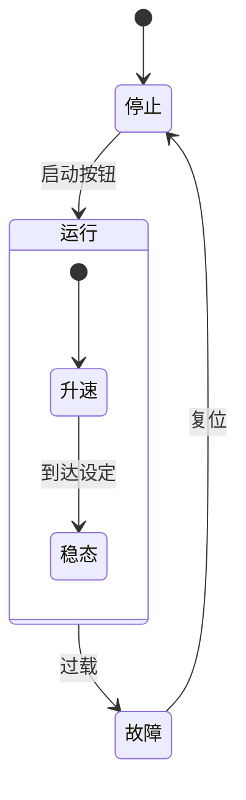
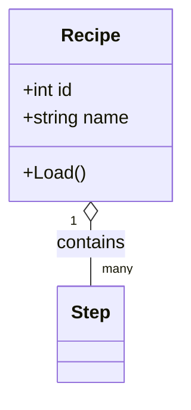
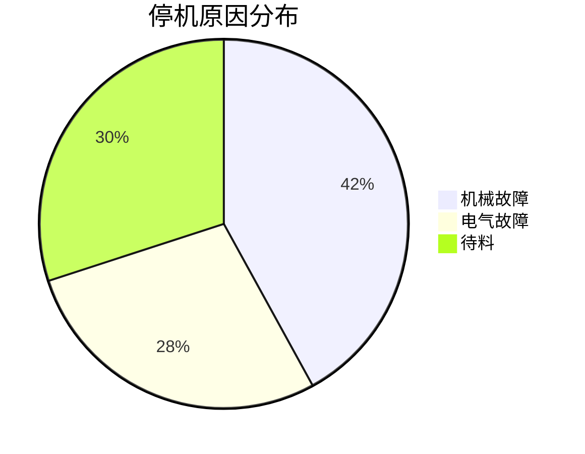

# Mermaid Diagrams (official renderer)

The chat UI renders diagrams with the **official mermaid.js v11** (embedded offline, WebView2 off-screen rendering); output matches GitHub / mermaid.live. Put the diagram in a ```mermaid fenced block whose first line is the type header (e.g. `flowchart TD`). Write standard official syntax — no need to accommodate a custom subset.

## All diagram types available

`flowchart`/`graph`, `stateDiagram-v2`, `sequenceDiagram`, `classDiagram`, `erDiagram`, `pie`, `gantt`, `journey`, `mindmap`, `timeline`, `quadrantChart`, `gitGraph`, `requirement`, C4, `xychart-beta`, `block-beta`, etc. Selection guidance: control flow → flowchart; device state machine → stateDiagram-v2; communication handshake → sequenceDiagram; data/recipe structure → classDiagram or erDiagram; proportions → pie; maintenance schedule → gantt.

## Hard rules (most common sources of render breakage)

1. **Node IDs use only ASCII letters, digits, and underscores** (`A`, `step1`, `valve_open`); put Chinese, emoji, spaces, and punctuation in the label.
2. **Quote any label containing spaces / Chinese / emoji / English parentheses () / commas / colons / arrows (->)**: `A["启动 ▶ 就绪 (Ready)"]`. When in doubt, quote it — the official parser also breaks on a bare `(`, `:`, etc.
3. Break long labels with `<br>`; move detail onto edge labels (`A -->|条件| B`).
4. A diagram with a syntax error does not blank the view: it falls back to a highlighted code block showing the source; fix the syntax to restore the diagram.

## Safe to use (older versions once lacked these; all available now)

- `A --> B & C` / `A & B --> C` fan-out/fan-in; `classDef`/`style`/`linkStyle`/`:::class` coloring; `%%{init}%%` config blocks; `A@{shape: ...}` new shape syntax; parallelogram `[/x/]`, trapezoid, double circle `(((x)))` and all shapes; arbitrary subgraph nesting + `direction` inside subgraphs; state-diagram transition labels `A --> B : 条件`, concurrency regions `--`, `<<choice>>`/`<<fork>>`; sequence-diagram `box` grouping, `create`/`destroy`, `rect` background blocks, `autonumber`, `note over A,B` spanning participants.
- Diagram size is no longer limited (large diagrams auto-scale to fit the card; users can zoom and pan).

## Fallback behavior (for context; no need to accommodate it)

In the rare case the target machine has no WebView2 runtime, rendering falls back to the native WPF renderer, which supports only the core syntax of three types — flowchart / stateDiagram-v2 / sequenceDiagram — and shows all other types as code blocks. Normally installed Windows 10/11 ship with WebView2, so there is no need to change how you write diagrams for this.

## Examples

**Motor start/stop state machine (with composite state and transition labels)**


**Recipe data structure (classDiagram)**


**Downtime-cause proportion (pie)**

